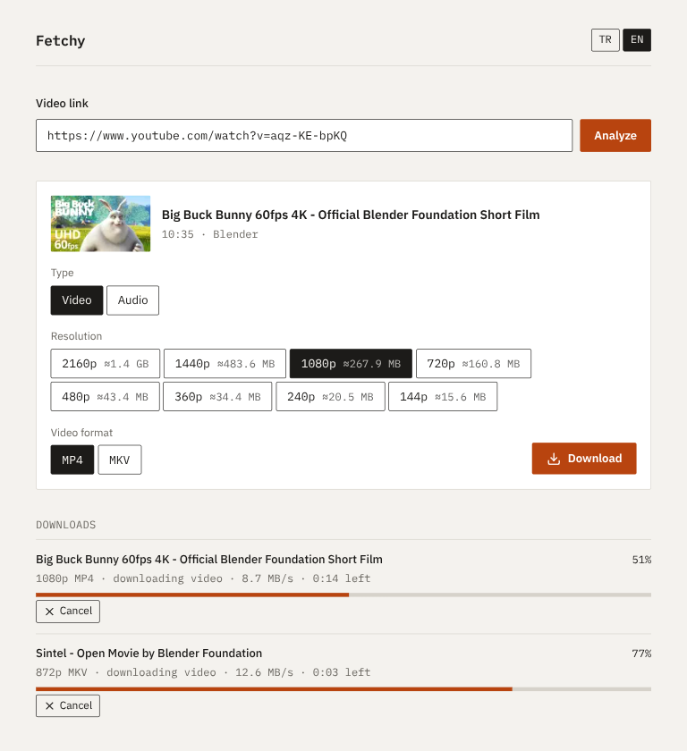

# Fetchy

A local web UI for [yt-dlp](https://github.com/yt-dlp/yt-dlp). Paste a link, choose video or audio and a quality, and Fetchy saves the file to a folder on your machine. It works with every site yt-dlp supports, runs only on `localhost` and needs no account or database.

## Features

- **Preview first:** title, channel, duration, thumbnail and every available resolution with its estimated size
- **Video:** MP4 or MKV, from 144p up to 4320p
- **Audio:** MP3 (320/192/128 kbps) or M4A
- **Playlists and channels:** up to 300 videos in one format, downloaded one by one into a folder named after the playlist; entries that fail are skipped
- **Concurrent downloads** with live progress, speed, ETA and cancel; the list survives a page refresh
- **Embedded metadata and cover art**
- Turkish and English UI; light and dark theme follow your system

Live streams can't be downloaded while they are live; past broadcasts work. Content behind a login isn't supported, because Fetchy doesn't pass cookies to yt-dlp.

## Tech stack

| Area      | Tools                                         |
| --------- | --------------------------------------------- |
| Framework | Next.js 16 (App Router), React 19, TypeScript |
| UI        | Tailwind CSS v4, lucide-react                 |
| Server    | Server Actions, Server-Sent Events, zod       |
| Media     | yt-dlp, ffmpeg, Deno                          |
| Testing   | Vitest, Testing Library, Playwright           |
| Tooling   | pnpm, ESLint, Prettier                        |

## Requirements

- Node.js 20.9 or newer and [pnpm](https://pnpm.io)
- These tools on your `PATH`:
  - [yt-dlp](https://github.com/yt-dlp/yt-dlp#installation) does the downloading
  - [ffmpeg](https://ffmpeg.org) merges streams, converts formats and embeds metadata
  - [Deno](https://deno.com) is the JavaScript runtime yt-dlp needs for YouTube

Developed and tested on Linux.

## Getting started

```sh
git clone https://github.com/batuhanmeral/media-downloader.git
cd media-downloader
pnpm install
cp .env.example .env.local
```

In `.env.local`, set `DOWNLOAD_DIR` to the absolute path of an existing, writable folder:

```sh
DOWNLOAD_DIR=/home/you/Videos/Fetchy
```

Build and start the app, then open http://localhost:3000:

```sh
pnpm build
pnpm start
```

The server checks `DOWNLOAD_DIR` at startup and stops with a clear error if the folder is missing or not writable. Files are named like `Title [id] 1080p.mp4` or `Title [id] 320k.mp3`; playlists go into `DOWNLOAD_DIR/<playlist title>/`.

Fetchy has no login and listens only on `localhost`; don't expose it to a network.

## Development

| Command                                              | Purpose                                           |
| ---------------------------------------------------- | ------------------------------------------------- |
| `pnpm dev`                                           | Dev server on localhost:3000                      |
| `pnpm test`                                          | Unit and component tests (Vitest)                 |
| `pnpm test:e2e`                                      | Playwright smoke test, downloads a real 19 s clip |
| `pnpm lint` / `pnpm typecheck` / `pnpm format:check` | ESLint, TypeScript, Prettier                      |

Feature code lives in `src/features/downloads/` (actions, yt-dlp services, components); translations are in `src/i18n/messages/`.

## Disclaimer

Download only content you have the right to download. You are responsible for respecting copyright and each site's terms of service.

## Screenshot



## License

[MIT](LICENSE)
